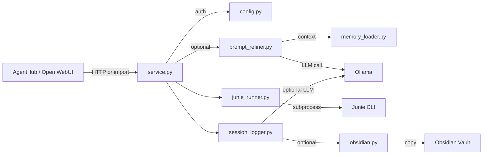

# Technical Design

### Current Implementation

Everything lives in `orchestrator.py` (690 lines). Key functions:

- `build_prompt(raw)` → calls Ollama, returns `(improved_prompt, fallback_flag, error_reason)`
- `run_junie(task)` → async subprocess, returns answer text
- `save_session_log(...)` → calls Ollama for summary, saves markdown file
- `load_memory_context()` → reads MEMORY.md + 3 recent session logs
- `_mirror_log_to_vault(log_file)` → copies to VAULT_PATH/Session-Logs/
- `chat_completions(request)` → FastAPI route, orchestrates the full pipeline
- `ollama_chat(messages)` / `ollama_chat_stream(messages)` → Ollama API calls
- `parse_junie_json(output)` → tolerant JSON parser
- `format_reply(...)` → markdown reply formatter
- SSE streaming helpers for OpenAI-compatible responses

Test suite: `tests/test_orchestrator.py` (841 lines, 60+ tests) with `fake_junie.py` mock.

### Key Decisions

1. **Package structure over monolith**: Split into `junie_adapter/` package. Each responsibility gets its own module. The HTTP service becomes an optional wrapper.
2. **Prompt refinement opt-in**: Default `REFINE_PROMPT=false`. Users who want refinement enable it. This eliminates the mandatory Ollama dependency.
3. **Memory is pluggable**: A `context_provider` callback allows AgentHub to inject its own context instead of relying on MEMORY.md.
4. **Obsidian fully optional**: No default vault path. All vault operations skip silently when `VAULT_PATH` is not set.
5. **Preserve backward compatibility**: The existing HTTP API endpoints remain unchanged. Existing Open WebUI configurations continue to work.
6. **Keep `orchestrator.py` as entry point**: Thin wrapper that imports from `junie_adapter/` and starts the FastAPI service. Preserves existing `uvicorn orchestrator:app` command.

### Proposed Changes

**New package: `junie_adapter/`**

- `config.py`: `OrchestratorConfig` dataclass with factory method `from_env()`. Validates required fields at startup. New env vars: `REFINE_PROMPT` (default `false`), `ENABLE_OBSIDIAN` (default `false`).
- `models.py`: `RunResult(task, answer, success, error, duration)`, `SessionLog(raw_prompt, refined_prompt, answer, timestamp, status)`, `ContextSource(type, content)`.
- `junie_runner.py`: `run_junie_task(task, config) → RunResult`. Contains subprocess management, JSON parsing, rate limit retries, timeout handling, process group killing. Platform-aware (Windows CREATE_NEW_PROCESS_GROUP vs Unix start_new_session).
- `prompt_refiner.py`: `refine_prompt(raw, config, context) → (improved, fallback, error)`. Calls Ollama with system prompt + context. Returns raw prompt on failure.
- `session_logger.py`: `log_session(session_log, config) → None`. Saves markdown file, optionally calls Ollama for summary, optionally mirrors to vault.
- `memory_loader.py`: `load_context(config) → str`. Reads MEMORY.md + recent session logs. Returns empty string if nothing exists.
- `obsidian.py`: `mirror_to_vault(source, config) → None`. Copies file to VAULT_PATH/Session-Logs/. Skips if VAULT_PATH not set.
- `service.py`: FastAPI app with routes. Imports from package modules. Orchestrates the pipeline: auth → optional refinement → Junie execution → session logging → response.
- `__init__.py`: Public API: `run_junie_task`, `refine_prompt`, `log_session`, `load_context`, `OrchestratorConfig`.

**Modified files:**
- `orchestrator.py`: Becomes a thin entry point (≈20 lines) importing from `junie_adapter.service`.
- `tests/test_orchestrator.py`: Updated to test individual modules + integration tests via service layer.
- `.env.example`: Updated with new optional flags.
- `requirements.txt`: No new dependencies.
- `README.md`: Complete rewrite with new architecture, module usage, HTTP service usage, config reference, platform support, AgentHub integration guide.
- `pyproject.toml`: New — Python package metadata.

### Architecture Diagram



### Data Models

```python
# models.py
from dataclasses import dataclass, field
from datetime import datetime
from enum import Enum
from typing import Optional

class TaskStatus(Enum):
    COMPLETED = "completed"
    FAILED = "failed"
    TIMED_OUT = "timed_out"
    INTERRUPTED = "interrupted"

@dataclass
class RunResult:
    task: str
    answer: str
    status: TaskStatus
    error: Optional[str] = None
    duration_seconds: float = 0.0

@dataclass
class SessionLog:
    raw_prompt: str
    refined_prompt: Optional[str] = None
    answer: str = ""
    status: TaskStatus = TaskStatus.COMPLETED
    timestamp: datetime = field(default_factory=datetime.now)
    error: Optional[str] = None

@dataclass
class OrchestratorConfig:
    ollama_url: str = "http://localhost:11434"
    ollama_model: str = "gemma4:12b"
    refine_prompt: bool = False
    workspace_path: Optional[str] = None
    vault_path: Optional[str] = None
    mirror_logs_to_vault: bool = False
    api_key: str = ""
    junie_timeout: int = 1800
    port: int = 8000
    junie_bin: str = "junie"
    vault_map_path: Optional[str] = None

    @classmethod
    def from_env(cls) -> "OrchestratorConfig":
        # Load from environment variables, validate required fields
        ...
```

### Integration Contract for AgentHub

AgentHub can use the package in two ways:

**1. Direct import (recommended):**
```python
from junie_adapter import run_junie_task, OrchestratorConfig
from junie_adapter.models import RunResult

config = OrchestratorConfig.from_env()
result: RunResult = await run_junie_task(
    task="Implement feature X",
    config=config,
    context="AgentHub-provided project context..."
)
```

**2. HTTP service:**
```bash
# Start standalone service
uvicorn junie_adapter.service:app --host 0.0.0.0 --port 8000
# Or use existing entry point
python -m orchestrator
```

AgentHub sends OpenAI-compatible requests to `POST /v1/chat/completions` with `Authorization: Bearer <API_KEY>`.

### Risks

- **Module re-import during tests**: The current test suite modifies module-level globals. The new package structure avoids this by using dependency injection (passing `Config` objects).
- **Junie CLI availability**: Junie is Linux-only. The package works on Windows for testing and configuration, but `run_junie_task` will fail on Windows without Junie installed. Documented clearly.
- **Backward compatibility**: Existing Open WebUI configs should continue working. The HTTP API surface is preserved.


# Delivery Steps

### ✓ Step 1: Phase 1: Refactor into Python package
Split `orchestrator.py` into a `junie_adapter/` package with modular components.
- Create `junie_adapter/` directory with `__init__.py`, `config.py`, `models.py`, `junie_runner.py`, `prompt_refiner.py`, `session_logger.py`, `memory_loader.py`, `obsidian.py`, `service.py`
- Move Junie subprocess logic (run_junie, parse_junie_json, has_rate_limit) → `junie_runner.py`
- Move Ollama prompt rewrite (build_prompt, build_prompt_system, ollama_chat, ollama_chat_stream) → `prompt_refiner.py`
- Move session logging (save_session_log) → `session_logger.py`
- Move memory loading (load_memory_context) → `memory_loader.py`
- Move vault mirroring (_mirror_log_to_vault) → `obsidian.py`
- Move config/env vars → `config.py` with `OrchestratorConfig` dataclass and `from_env()` factory
- Move FastAPI routes and helpers → `service.py`
- Add `models.py` with `RunResult`, `SessionLog`, `TaskStatus` dataclasses
- Update `orchestrator.py` to be a thin entry point (≈20 lines) importing from `junie_adapter.service`
- Preserve all existing behavior: same CLI flags, JSON parsing, retry logic, API endpoints

### ✓ Step 2: Phase 2: Make prompt refinement optional
Add `REFINE_PROMPT` config flag (default `false`) so the default path skips Ollama entirely.
- Add `refine_prompt: bool = False` to `OrchestratorConfig`
- In `service.py` chat completions handler: skip `build_prompt()` when `refine_prompt` is `False`
- When disabled: send raw prompt directly to `run_junie_task()`, skip second Ollama call for session summary
- Preserve original prompt alongside refined prompt in session logs
- Update `format_reply()` to show "Original prompt" when refinement was used and prompt differs
- Add tests: refinement disabled path, refinement enabled path, refinement with Ollama failure

### ✓ Step 3: Phase 3: Make Obsidian optional and remove hardcoded paths
Remove `/mnt/vault` hardcoded default and make all vault operations conditional.
- Change `VAULT_PATH` default from `/mnt/vault` to `None` in `config.py`
- Skip all vault-related operations (mirroring, vault map loading) when `VAULT_PATH` is not configured
- Remove vault mount requirements from setup scripts documentation
- Update `.env.example` to show `VAULT_PATH` as optional
- Add tests: obsidian disabled by default, obsidian enabled with valid path, obsidian with missing path doesn't crash

### ✓ Step 4: Phase 4: Pluggable memory and context
Make memory loading pluggable so AgentHub can inject its own context.
- Add `context_provider` parameter to the main execution flow in `service.py`
- Default context provider: `memory_loader.py` reads MEMORY.md + session logs
- Allow passing a custom context string (from AgentHub) that replaces the default memory loading
- Make `WORKSPACE_PATH` optional — fall back to a temp directory if not set
- Remove the assumption that MEMORY.md must exist
- Add tests: default memory loading, custom context injection, missing MEMORY.md doesn't crash

### ✓ Step 5: Phase 5: Configuration validation, portability, and package metadata
Add startup validation, platform documentation, and proper package structure.
- Add startup validation in `config.py`: check required config (API_KEY), produce actionable error messages
- Add `pyproject.toml` with package metadata (name, version, dependencies, entry points)
- Document platform support: Junie CLI is Linux-only, Ollama is cross-platform, Python package works anywhere
- Update `.env.example` with all new optional flags (REFINE_PROMPT, ENABLE_OBSIDIAN)
- Keep `setup.sh`, `start.sh`, `install_service.sh` as optional deployment scripts (not required for module usage)
- Fix the `runs_logger` ordering bug (line 41 references logger defined at line 63)

### ✓ Step 6: Phase 6: Update tests and README
Update test suite for modular structure and rewrite README with new architecture.
- Update `tests/test_orchestrator.py` to test individual modules (junie_runner, prompt_refiner, session_logger, memory_loader, obsidian, config)
- Add new tests: refinement disabled, Ollama unavailable, Obsidian disabled, invalid config validation, pluggable context
- Keep existing integration tests passing via the service layer
- Rewrite `README.md` with: new architecture overview, module usage (import directly), HTTP service usage, configuration reference, platform support matrix, AgentHub integration guide, exact setup instructions
- Run full test suite and verify all tests pass