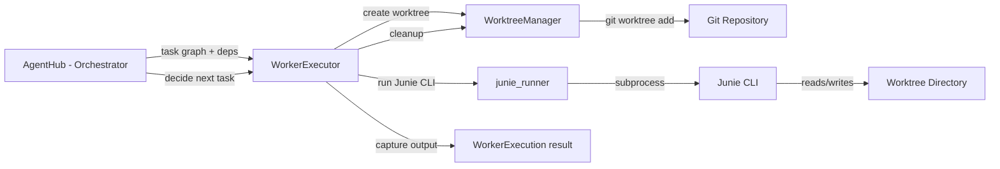

# Requirements

### Overview & Goals

Investigate whether multiple independent Junie CLI agents (Junie Lite) can collaborate on the same software project, and prepare the `junie_adapter` package to support multi-agent orchestration from AgentHub. The goal is a **feasibility report** backed by evidence from the installed CLI and official documentation, plus a **tested foundation** for running isolated worker tasks — without implementing a full multi-agent system.

### Scope

**In Scope:**
- Feasibility report answering 6 key questions about Junie Lite multi-agent capabilities
- New `WorkerExecution` abstraction in `models.py` for representing worker tasks
- New `worker_executor.py` module for single-worker execution with proper isolation
- Git worktree management module (`worktree_manager.py`) for concurrent worker isolation
- Tests for the new execution and worktree modules (mocked, no live Junie required)
- Backward compatibility: existing `run_junie_task()` API unchanged
- Documentation of limitations and what remains for AgentHub

**Out of Scope:**
- Full multi-agent orchestration logic (task graph, dependency resolution, etc.) — that belongs in AgentHub
- Automatic merging of worker changes
- A separate multi-agent application or mandatory additional service
- Undocumented CLI flags or assumed features

### User Stories

1. As an AgentHub developer, I want a documented feasibility report so I know what Junie Lite supports for multi-agent workflows.
2. As an AgentHub developer, I want a `WorkerExecution` model so I can track worker tasks with IDs, status, timestamps, and output.
3. As an AgentHub developer, I want worktree-based isolation so concurrent workers don't conflict on the same files.
4. As an existing user, I want the single-agent API (`run_junie_task`) to continue working without changes.

### Functional Requirements

- **FR1**: The feasibility report must answer each of the 6 questions with evidence (CLI version, `--help` output, documentation links, YouTrack issues).
- **FR2**: A single Junie execution must remain usable without enabling multi-agent orchestration.
- **FR3**: Worker execution must capture: worker ID, task ID, parent task ID, description, project/worktree paths, status, PID, timestamps, output, errors, exit status, result summary, changed files.
- **FR4**: Worktree creation must validate Git repo state, use unique names, and handle crashes/leftover worktrees.
- **FR5**: Non-Git projects must fall back to single-agent execution with a clear error.
- **FR6**: Maximum concurrent workers must be configurable with a conservative default.
- **FR7**: Per-task timeouts must be enforced; output capture must not allow unbounded memory growth.

### Non-Functional Requirements

- **NFR1**: No live Junie account or model usage required for unit tests.
- **NFR2**: The feature must be opt-in; existing behavior is unchanged.
- **NFR3**: Platform support: worktree management works on Linux/macOS/Windows (Git is cross-platform).
- **NFR4**: Subprocess management is separated from orchestration policy.


# Technical Design

### Current Implementation

The `junie_adapter` package is a modular Python package with these modules:
- **`config.py`** — `OrchestratorConfig` dataclass with `from_env()` factory. Holds workspace path, Junie binary, timeout, Ollama settings, Obsidian vault path.
- **`models.py`** — `RunResult` (task, answer, status, error, duration), `SessionLog`, `TaskStatus` enum (COMPLETED, FAILED, TIMED_OUT, INTERRUPTED).
- **`junie_runner.py`** — `run_junie_task()` launches Junie CLI as subprocess with `--task`, `--project`, `--output-format json`. Handles retries on rate limit, timeout killing via process groups, JSON parsing.
- **`service.py`** — FastAPI HTTP service with `junie_lock` (asyncio.Lock) enforcing single-run. OpenAI-compatible `/v1/chat/completions` endpoint.
- **`prompt_refiner.py`** — Ollama-based prompt refinement (opt-in).
- **`session_logger.py`** — Session log persistence to `session-logs/` dir.
- **`memory_loader.py`** — Loads `MEMORY.md` and recent session summaries.
- **`obsidian.py`** — Optional vault mirroring.

Tests use `tests/fake_junie.py` (a Python script simulating Junie JSON output) and cover all modules without requiring a live Junie installation.

### Key Findings from Junie CLI Investigation

**Installed version**: Junie 26.10.12 (build 3659.7)

**Headless mode**: Fully supported. Flags: `--task`, `--project`, `--output-format json|json-stream`, `--input-format text|json`, `--auth` for token auth, `--model`, `--provider` for BYOK.

**Gateway mode**: `--gateway` flag runs Junie as a headless worker executing gateway commands (e.g., cron jobs). With `--verbose`, streams transcript to process output. Designed for scheduled/remote tasks.

**Subagents**: Available in Junie CLI but **managed internally** by the main Junie session. The main agent delegates to subagents automatically. Not exposed as independent CLI processes. Configurable via `/settings` → Subagents (SameModelOnly vs Auto mode).

**Worktrees**: Supported via interactive `/worktree` command and `/new` for parallel sessions. **No CLI flag** for non-interactive worktree creation — the agent must be told to create/switch worktrees via the task prompt.

**Critical limitation (JUNIE-3394)**: "Junie CLI currently allows only **one active remote session per project**, and that restriction spans every git worktree of the repository." This means multiple independent Junie CLI processes targeting the same project root will conflict.

**Authentication**: `--auth` token (from junie.jetbrains.com/cli), or BYOK provider keys (`--openai-api-key`, `--anthropic-api-key`, etc.). Each process needs its own auth.

**Session management**: `--session-id` for following up on previous sessions, `--resume` for resuming. Sessions are stored locally in `~/.junie/sessions/`.

### Key Decisions

1. **Externally orchestrated workers, not built-in subagents**. Junie's subagents are internal to a single session and not accessible as independent processes. AgentHub must orchestrate multiple Junie CLI invocations externally.

2. **Worktree isolation via Git CLI, not Junie CLI**. Since Junie has no `--worktree` flag for non-interactive use, the adapter must create worktrees via `git worktree add` before launching Junie, then pass the worktree path as `--project`.

3. **Sequential execution by default due to JUNIE-3394**. The one-session-per-project restriction means true parallel workers on the same repo are not reliably supported. The adapter will support worktree isolation but default to sequential execution or warn about the limitation.

4. **WorkerExecution model extends RunResult**. Rather than replacing `RunResult`, a new `WorkerExecution` dataclass will add worker-specific fields (worker_id, task_id, parent_task_id, worktree_path, pid, changed_files) while keeping `RunResult` for backward compatibility.

5. **Opt-in feature**. The multi-agent foundation is behind a new module (`worker_executor.py`, `worktree_manager.py`) that existing code doesn't import. The single-agent path (`run_junie_task`) is untouched.

### Proposed Changes

#### 1. Feasibility Report (`docs/multi-agent-feasibility.md`)

A Markdown document answering the 6 required questions with evidence:

1. **Can Junie Lite be launched through the required CLI mode?** Yes — headless mode with `--task`, `--output-format json`, `--auth` token. Verified against installed CLI v26.10.12.
2. **Can multiple independent Junie Lite processes run simultaneously?** Limited — JUNIE-3394 restricts to one active session per project. Worktrees don't bypass this. BYOK auth may allow separate sessions but is unverified.
3. **Are built-in subagents available for Junie Lite?** Yes, but internal to a single session. Not accessible as independent processes.
4. **Known rate limits, concurrency constraints, auth restrictions?** One session per project (JUNIE-3394). Rate limiting exists (429 errors, handled by existing retry logic). Auth requires a token per process.
5. **Which orchestration responsibilities must be implemented externally?** Task graph, dependency resolution, worker scheduling, result validation, merge coordination, cleanup policy.
6. **Simplest reliable proof of concept?** Sequential workers with worktree isolation: create worktree → run Junie → capture result → merge or review.

#### 2. New Models (`junie_adapter/models.py`)

Add to existing `models.py`:
- `WorkerStatus` enum: QUEUED, RUNNING, COMPLETED, FAILED, TIMED_OUT, CANCELLED, INTERRUPTED
- `WorkerExecution` dataclass: worker_id, task_id, parent_task_id, task_description, project_path, worktree_path, status, pid, start_time, end_time, stdout, stderr, exit_code, result_summary, changed_files, error

#### 3. Worktree Manager (`junie_adapter/worktree_manager.py`)

- `create_worktree(project_path: Path, worker_id: str) -> WorktreeInfo` — creates a Git worktree outside the main checkout with a unique branch name
- `remove_worktree(worktree_path: Path) -> bool` — removes a worktree and its branch
- `validate_git_repo(project_path: Path) -> bool` — checks if path is a valid Git repo
- `cleanup_orphaned_worktrees(project_path: Path, base_dir: Path) -> list[Path]` — finds and removes leftover worktrees from crashed runs
- `WorktreeInfo` dataclass: worktree_path, branch_name, project_path

#### 4. Worker Executor (`junie_adapter/worker_executor.py`)

- `execute_worker(task_description: str, config: OrchestratorConfig, worker_id: str, task_id: str, ...) -> WorkerExecution` — single-worker execution with worktree isolation, timeout, output capture, changed-file detection
- Reuses `run_junie_task()` internally but wraps it with worker metadata
- Configurable max concurrent workers (default: 1 due to JUNIE-3394)
- Output capture with memory limit

#### 5. Updated `__init__.py`

Export new public symbols: `WorkerExecution`, `WorkerStatus`, `execute_worker`, `create_worktree`, `remove_worktree`.

#### 6. Tests (`tests/test_worker_executor.py`, `tests/test_worktree_manager.py`)

- Worktree creation, removal, validation, orphan cleanup (using real Git in temp dirs)
- Worker execution with mocked Junie (fake_junie.py)
- Concurrent execution limits
- Task dependency simulation
- Worker failure and timeout handling
- Output and result capture
- Git conflict detection
- Cancellation
- Backward compatibility with existing single-agent usage
- Opt-in integration test marker for live Junie (skipped by default)

### File Structure

```
junie_adapter/
├── __init__.py          # Modified: add new exports
├── config.py            # Unchanged
├── models.py            # Modified: add WorkerStatus, WorkerExecution
├── junie_runner.py      # Unchanged
├── worker_executor.py   # NEW: single-worker execution with metadata
├── worktree_manager.py  # NEW: Git worktree lifecycle management
├── prompt_refiner.py    # Unchanged
├── session_logger.py    # Unchanged
├── memory_loader.py     # Unchanged
├── obsidian.py          # Unchanged
└── service.py           # Unchanged

docs/
└── multi-agent-feasibility.md  # NEW: feasibility report

tests/
├── test_orchestrator.py     # Unchanged
├── test_worker_executor.py  # NEW: worker execution tests
└── test_worktree_manager.py # NEW: worktree management tests
```

### Architecture Diagram



AgentHub owns orchestration policy (task graph, dependencies, scheduling). The adapter provides execution (`worker_executor`) and isolation (`worktree_manager`). Junie CLI runs in a worktree directory and produces results captured by the executor.

### Risks

- **JUNIE-3394**: The one-session-per-project restriction may make true parallel execution unreliable. Mitigation: default to sequential execution, document the limitation, allow users to override.
- **Worktree cleanup**: Crashed workers may leave orphaned worktrees. Mitigation: `cleanup_orphaned_worktrees()` scans for stale worktrees.
- **Git not available**: Non-Git projects can't use worktree isolation. Mitigation: fall back to single-agent execution with a clear error.
- **BYOK authentication**: Each worker process needs its own auth token. Mitigation: pass auth via `--auth` flag or environment variable per worker.


# Delivery Steps

### ✓ Step 1: Write feasibility report
Create `docs/multi-agent-feasibility.md` with evidence-based answers to the 6 required questions.
- Document installed Junie CLI version (26.10.12, build 3659.7) and verified CLI flags from `--help` output.
- Answer each question with references to official documentation, YouTrack issues (JUNIE-3394), and observed behavior.
- Clearly label unverified assumptions (e.g., BYOK multi-process behavior) vs confirmed facts.
- Include the simplest reliable proof-of-concept workflow.

### ✓ Step 2: Add WorkerExecution model and WorkerStatus enum
Extend `junie_adapter/models.py` with worker-specific data models.
- Add `WorkerStatus` enum: QUEUED, RUNNING, COMPLETED, FAILED, TIMED_OUT, CANCELLED, INTERRUPTED.
- Add `WorkerExecution` dataclass with fields: worker_id, task_id, parent_task_id, task_description, project_path, worktree_path, status, pid, start_time, end_time, stdout, stderr, exit_code, result_summary, changed_files (list[str]), error.
- Keep existing `RunResult`, `SessionLog`, and `TaskStatus` unchanged for backward compatibility.
- Update `junie_adapter/__init__.py` to export the new symbols.

### ✓ Step 3: Implement worktree manager
Create `junie_adapter/worktree_manager.py` for Git worktree lifecycle management.
- `WorktreeInfo` dataclass: worktree_path, branch_name, project_path.
- `validate_git_repo(project_path)` — checks if path is a valid Git repo via `git rev-parse`.
- `create_worktree(project_path, worker_id)` — creates a worktree outside the main checkout with a unique branch name (`junie-worker-{worker_id}-{timestamp}`).
- `remove_worktree(worktree_path)` — removes worktree and its branch via `git worktree remove` and `git branch -d`.
- `cleanup_orphaned_worktrees(project_path, base_dir)` — scans for leftover worktrees from crashed runs.
- Handle edge cases: uncommitted changes, non-Git repos, missing Git binary.
- Add tests in `tests/test_worktree_manager.py` using real Git in temp directories.

### ✓ Step 4: Implement worker executor
Create `junie_adapter/worker_executor.py` for single-worker execution with metadata and isolation.
- `execute_worker(task_description, config, worker_id, task_id, ...)` — wraps `run_junie_task()` with worker metadata.
- Creates a worktree via `WorktreeManager` before execution (if Git repo).
- Captures stdout/stderr with memory limit (configurable, default 10MB).
- Detects changed files via `git diff --name-only` after execution.
- Records PID, timestamps, exit code, and result summary in a `WorkerExecution` object.
- Enforces per-task timeout (from config, default 1800s).
- Supports cancellation via process group killing.
- Default max concurrent workers: 1 (due to JUNIE-3394), configurable.
- Add tests in `tests/test_worker_executor.py` using `fake_junie.py` and mocked worktree manager.

### ✓ Step 5: Add tests and finalize
Complete test coverage and finalize the implementation.
- Tests for worktree manager: creation, removal, validation, orphan cleanup, non-Git fallback, crash recovery.
- Tests for worker executor: success path, failure, timeout, cancellation, output capture, changed-file detection, concurrent limits.
- Backward compatibility test: verify `run_junie_task()` still works identically.
- Opt-in integration test marker (`@pytest.mark.integration`) for live Junie — skipped by default.
- Update `junie_adapter/__init__.py` with all new exports.
- Run full test suite: `pytest` to confirm no regressions.