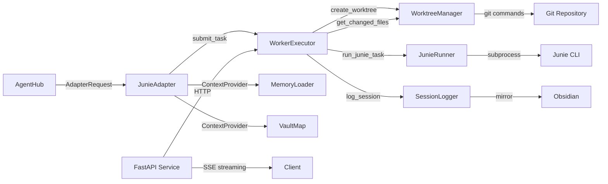

# Requirements

### Overview & Goals

Stabilize JunieOrchestrator as a reliable, reusable execution backend for AgentHub. The focus is on fixing foundational worker isolation and execution lifecycle bugs, hardening the HTTP service, and defining a clean adapter interface — without adding speculative features.

### Scope

**In Scope:**
- Fix Git worktree creation to actually use branches (not detached HEAD).
- Implement comprehensive changed-file and diff detection.
- Harden worker execution (isolation, timeouts, cleanup, concurrency).
- Fix configuration bugs (workspace fallback, optional dependencies).
- Introduce a pluggable context provider interface.
- Make streaming semantics honest and documented.
- Define a stable adapter interface for AgentHub.
- Ensure multi-worker readiness with concurrency limits.
- Run and extend the test suite.
- Update documentation.

**Out of Scope:**
- Building a second task coordinator (AgentHub owns orchestration).
- Adding new dependencies without justification.
- Making Obsidian or Ollama mandatory.
- Duplicating AgentHub's session/memory system.
- Real-time streaming from Junie CLI (unless the CLI supports it reliably).

### User Stories

- As an AgentHub developer, I want to submit a task with a project path and receive structured results (output, changed files, status) so I can integrate JunieOrchestrator as an execution backend.
- As a multi-agent orchestrator, I want each worker to run in an isolated Git worktree so workers don't interfere with each other or the main checkout.
- As a service operator, I want Obsidian and Ollama to be optional so the service starts without them.
- As a developer, I want accurate changed-file reporting (including untracked, staged, deleted, renamed files) so I can review worker changes.
- As a service consumer, I want honest streaming responses so I know whether output is live or post-completion.

### Functional Requirements

1. **Worktree isolation**: Each worker gets a unique, attached Git branch (not detached HEAD). Worktrees are created outside the main checkout. Cleanup is safe and idempotent.
2. **Changed-file detection**: Report modified, added, deleted, renamed, staged, unstaged, and untracked files. Provide diff content and summary.
3. **Worker execution**: Isolated worktrees, explicit timeouts, output capture, PID tracking, proper cleanup, no shared mutable state.
4. **Configuration**: No workspace fallback to VAULT_PATH. Obsidian and Ollama are optional. Prompt refinement disabled by default. Workspace paths validated.
5. **Streaming**: Truthful SSE events. Post-completion streaming documented. Progress events distinct from token chunks.
6. **Adapter interface**: Typed request/result models. Health check, task submission, changed-file reporting, cancellation, cleanup.
7. **Multi-worker**: Unique IDs, separate worktrees, per-worker timeout/status, configurable concurrency limits (default 1 per JUNIE-3394).

### Non-Functional Requirements

- No new dependencies without justification.
- Tests must not require live Junie or Ollama.
- Secrets not written to logs.
- API compatibility preserved where practical.
- No silent data loss or uncommitted changes discarded.

# Technical Design

### Current Implementation

The project is a modular Python package (`junie_adapter`) with these key components:

| File | Purpose | Lines |
|------|---------|-------|
| `config.py` | `OrchestratorConfig` dataclass + `from_env()` factory | 72 |
| `models.py` | `RunResult`, `SessionLog`, `TaskStatus`, `WorkerExecution`, `WorkerStatus` | 66 |
| `junie_runner.py` | Junie CLI subprocess execution, JSON parsing, rate-limit retries | 207 |
| `prompt_refiner.py` | Ollama-based prompt refinement (optional) | 135 |
| `session_logger.py` | Session log persistence, Ollama summary | 68 |
| `memory_loader.py` | MEMORY.md + session log context loading | 67 |
| `obsidian.py` | Mirror session logs to Obsidian vault | 22 |
| `service.py` | FastAPI HTTP service with `/v1/chat/completions` | 292 |
| `worktree_manager.py` | Git worktree lifecycle management | 273 |
| `worker_executor.py` | Single-worker execution with worktree isolation | 237 |
| `orchestrator.py` | Thin entry point (17 lines) importing from `service.py` |

71 tests pass (1 skipped). All use mocks/fake Junie — no live Junie required.

### Bugs Identified

1. **`worktree_manager.py:119`** — `create_worktree()` generates `branch_name` but uses `git worktree add --detach`. The branch is never created; worktree is detached HEAD.
2. **`worktree_manager.py:260`** — `get_changed_files()` only runs `git diff --name-only HEAD`, missing untracked, staged, deleted, and renamed files.
3. **`worker_executor.py:176`** — `config.workspace_path = original_workspace_path` mutates the shared config object in `finally`, creating a race condition with concurrent workers.
4. **`service.py:159`** — `stream_progress()` sends the entire reply in one chunk after Junie completes. Not real streaming.
5. **`service.py:253-261`** — `junie_lock.acquire()` always returns `True` for `asyncio.Lock`, making the "busy" path unreachable. Lock release is not in a proper `finally`.
6. **`config.py:46-47`** — Workspace falls back to `VAULT_PATH` if `WORKSPACE_PATH` is not set (workspace fallback bug).
7. **No context provider interface** — Context loading is tightly coupled to `memory_loader.py` and Obsidian.
8. **No adapter interface** — No clean, documented interface for AgentHub.
9. **`remove_worktree()`** — Does not clean up the associated branch; `shutil.rmtree` fallback is too aggressive.
10. **No concurrency limits** — No `max_concurrent_workers` config or enforcement.

### Key Decisions

1. **Worktree branches**: Use `git worktree add -b <branch>` instead of `--detach`. Each worker gets a real, named branch for review and potential merge.
2. **Streaming honesty**: Document that streaming is post-completion. Add distinct progress event types instead of disguising them as token chunks.
3. **Context provider interface**: Introduce a `ContextProvider` protocol so context can come from different sources without coupling core execution to Obsidian.
4. **Adapter interface**: Create a `JunieAdapter` class with typed request/result models for clean AgentHub integration.
5. **Concurrency default**: Default `max_concurrent_workers=1` per JUNIE-3394 (one session per project restriction). Allow configuration override.
6. **Config mutation**: Use local config copies instead of mutating the shared `OrchestratorConfig` object.
7. **Safe cleanup**: Restrict `shutil.rmtree` fallback to `.junie-worktrees` directories only. Never delete worktrees with unreviewed changes automatically.

### Proposed Changes

#### Priority 1 — Worktree correctness (`worktree_manager.py`)
- Replace `git worktree add --detach` with `git worktree add -b <branch_name> <base>`.
- Add branch collision handling (append counter suffix if branch exists).
- Record `base_commit` SHA in `WorktreeInfo`.
- Add `validate_worktree_registered()` check.
- Fix `remove_worktree()` to clean up the branch and restrict fallback deletion.
- Add `cleanup_branch()` helper.

#### Priority 2 — Changed-file detection (`worktree_manager.py`)
- Rewrite `get_changed_files()` to cover all change categories.
- Add `get_worker_diff()` for structured diff data.
- Add `get_change_summary()` for human-readable summaries.
- Handle paths with spaces via null-terminated Git output.

#### Priority 3 — Worker execution hardening (`worker_executor.py`)
- Fix config mutation: use local config copy.
- Add explicit non-Git repo handling.
- Ensure timeout records `TIMED_OUT` status.
- Add PID capture.
- Add `max_concurrent_workers` enforcement via semaphore.
- Add per-worker log file path.

#### Priority 4 — Configuration and context providers
- Fix workspace fallback bug in `config.py`.
- Add `validate_workspace()` method.
- Add `isolation_mode` config option.
- Create `context_provider.py` with `ContextProvider` protocol and implementations.
- Update `memory_loader.py` to use the new interface.

#### Priority 5 — Streaming and service hardening (`service.py`)
- Replace `@app.on_event("startup")` with lifespan handler.
- Fix lock handling with proper `finally` block.
- Add distinct progress event types for SSE.
- Add client disconnect handling.
- Add proper error responses (503 busy, 504 timeout).
- Avoid logging full prompts.

#### Priority 6 — Adapter interface (`adapter.py`)
- Create `JunieAdapter` class with typed request/result models.
- Methods: `check_health()`, `submit_task()`, `get_changed_files()`, `cancel_task()`, `cleanup_worktree()`.
- Export from `__init__.py`.

#### Priority 7 — Multi-worker readiness
- Add `WorkerRegistry` for tracking active workers.
- Add concurrency enforcement via `asyncio.Semaphore`.
- UUID-based worker IDs if not provided.
- Document JUNIE-3394 limitation.

#### Priority 8 — Tests and documentation
- Extend test suite with regression coverage.
- Update README with accurate instructions.
- Update multi-agent feasibility doc.

### File Structure

```
junie_adapter/
├── __init__.py          # Updated exports (adapter interface)
├── config.py            # Fixed: workspace fallback, new fields
├── models.py            # Extended: diff models, adapter models
├── junie_runner.py      # Preserved (working)
├── prompt_refiner.py    # Preserved (working)
├── session_logger.py    # Preserved (working)
├── memory_loader.py     # Updated: uses context provider interface
├── obsidian.py          # Preserved (working)
├── service.py           # Fixed: streaming, lock, lifespan
├── worktree_manager.py  # Fixed: branches, diff detection
├── worker_executor.py   # Fixed: isolation, config mutation, concurrency
├── context_provider.py  # NEW: pluggable context provider interface
└── adapter.py           # NEW: stable adapter interface for AgentHub

tests/
├── test_orchestrator.py # Extended: config, service, streaming
├── test_worker_executor.py # Extended: isolation, timeout, concurrency
├── test_worktree_manager.py # Extended: branches, diff detection
├── test_adapter.py      # NEW: adapter interface tests
└── fake_junie.py        # Extended: more test modes
```

### Architecture Diagram



### Risks

1. **JUNIE-3394**: One active session per project. Default concurrency = 1. Parallel workers may fail.
2. **Junie CLI output**: Not reliably streamable. Streaming is post-completion.
3. **Windows Git**: Git worktree commands may behave differently on Windows. Tests run on Windows.
4. **Config mutation**: Existing code mutates shared config. Fix requires careful testing.
5. **Backward compatibility**: Existing API contract must be preserved where practical.

# Testing

### Validation Approach

Run the full test suite after each stage. All tests use temporary Git repositories, fake Junie executables, and mocks — no live Junie or Ollama required.

### Key Scenarios

**Worktree correctness:**
- Worktree creation attaches to a real branch (verify with `git branch` in worktree).
- Branch collision handling (create two worktrees with same worker ID).
- Concurrent worktree isolation (two workers, different worktrees).
- Dirty main working tree preservation (modify main tree, create worktree, verify main tree unchanged).
- Worktree validation (confirm Git tracks the worktree).

**Changed-file detection:**
- Untracked files detected.
- Staged files detected.
- Unstaged files detected.
- Deleted files detected.
- Renamed files detected (where Git detects them).
- Empty changes return empty list.
- Paths with spaces handled correctly.

**Worker execution:**
- Successful execution returns `COMPLETED` status.
- Non-zero exit code returns `FAILED` status.
- Timeout returns `TIMED_OUT` status.
- Non-Git repo with isolation requested raises or warns clearly.
- Config mutation does not affect shared config.
- Concurrent workers don't share worktrees or branches.
- Cleanup runs on both success and failure.

**Configuration:**
- Workspace does not fall back to VAULT_PATH.
- Obsidian disabled by default.
- Prompt refinement disabled by default.
- Missing Ollama does not crash the service.
- Invalid workspace path produces useful error.

**Streaming:**
- Streaming events contain truthful progress information.
- Non-streaming requests work correctly.
- Busy handling returns 503.
- Session logging records actual result.

**Adapter interface:**
- `check_health()` returns correct status.
- `submit_task()` returns structured `AdapterResult`.
- `get_changed_files()` reports changes.
- `cleanup_worktree()` removes worktree safely.

### Edge Cases

- Worktree creation fails (disk full, permission denied).
- Junie process hangs (timeout handling).
- Junie process crashes (exit code capture).
- Concurrent workers with same project.
- Client disconnect during streaming.
- Missing Git binary.
- Empty repository (no commits).
- Repository with existing user modifications.

### Test Changes

- **New**: `tests/test_adapter.py` — adapter interface tests.
- **Extended**: `tests/test_worktree_manager.py` — branch attachment, diff detection, collision handling.
- **Extended**: `tests/test_worker_executor.py` — config mutation, concurrency, non-Git handling.
- **Extended**: `tests/test_orchestrator.py` — streaming events, busy handling, context providers.
- **Extended**: `tests/fake_junie.py` — additional test modes (non-zero exit, slow response).

# Delivery Steps

### ✓ Step 1: Fix Git worktree creation and branch attachment
**Outcome**: `create_worktree()` creates an actual branch and attaches the worktree to it, with collision handling and proper cleanup.

- In `junie_adapter/worktree_manager.py`, replace `git worktree add --detach` with `git worktree add -b <branch>` to create and attach the branch.
- Add branch existence check before creation to handle collisions (append a counter suffix).
- Record `base_commit` SHA in `WorktreeInfo` for later diff comparison.
- Add `validate_worktree_registered()` to confirm Git tracks the worktree before returning.
- In `remove_worktree()`, delete the associated branch after removing the worktree, and restrict `shutil.rmtree` fallback to only `.junie-worktrees` directories.
- Add `cleanup_branch()` helper to remove orphaned branches safely.
- Update `tests/test_worktree_manager.py`: add tests for branch attachment verification, collision handling, concurrent creation, dirty main tree preservation, and safe cleanup.

### ✓ Step 2: Implement comprehensive changed-file and diff detection
**Outcome**: `get_changed_files()` and new `get_worker_diff()` report all categories of changes with proper diff content.

- In `junie_adapter/worktree_manager.py`, rewrite `get_changed_files()` to use:
  - `git diff --name-only HEAD` for modified tracked files
  - `git diff --cached --name-only` for staged changes
  - `git ls-files --others --exclude-standard` for untracked files
  - `git diff --name-status HEAD` for added/deleted/renamed classification
- Add `get_worker_diff(worktree_path, base_commit)` returning structured diff data (file path, status, diff content, summary).
- Add `get_change_summary(worktree_path)` returning a human-readable summary for AgentHub.
- Handle paths with spaces by using `-z` (null-terminated) Git output where available.
- Update `tests/test_worktree_manager.py`: add tests for untracked files, staged files, unstaged files, deleted files, renamed files, empty changes, and mixed scenarios.

### ✓ Step 3: Harden worker execution and isolation
**Outcome**: Workers run in isolated worktrees with proper timeout, output capture, cleanup, and no shared mutable state.

- In `junie_adapter/worker_executor.py`:
  - Fix the config mutation bug: use a local copy of config instead of mutating the shared object in `finally`.
  - Add explicit non-Git repo handling: raise or warn clearly when isolation is requested but the project is not a Git repo.
  - Ensure timeout kills the Junie process and records `TIMED_OUT` status (not `COMPLETED`).
  - Add PID capture from the subprocess.
  - Ensure cleanup runs on both success and failure without destroying unreviewed work.
  - Add `max_concurrent_workers` config option and a semaphore-based concurrency limiter.
  - Add per-worker log file path to `WorkerExecution`.
- In `junie_adapter/config.py`: add `max_concurrent_workers` field (default 1, per JUNIE-3394).
- Update `tests/test_worker_executor.py`: add tests for concurrent worker isolation, timeout cleanup, non-Git repo handling, and config mutation safety.

### ✓ Step 4: Fix configuration, context providers, and optional dependencies
**Outcome**: Configuration is clean, Obsidian/Ollama are truly optional, and context loading uses a pluggable interface.

- In `junie_adapter/config.py`:
  - Remove the `VAULT_PATH` fallback for `WORKSPACE_PATH` (the workspace fallback bug).
  - Add `validate_workspace()` method to check workspace path exists and is writable.
  - Add `isolation_mode` enum: `WORKTREE`, `NONE`, `REQUIRED` (required raises if not a Git repo).
- Create `junie_adapter/context_provider.py`:
  - Define `ContextProvider` protocol with `load_context() -> str` method.
  - Implement `MemoryFileContextProvider` (loads MEMORY.md + session logs).
  - Implement `VaultMapContextProvider` (loads vault map).
  - Implement `CompositeContextProvider` (combines multiple providers).
  - Implement `EmptyContextProvider` (returns empty string).
- Update `junie_adapter/memory_loader.py` to use the new provider interface.
- Ensure `session_logger.py` does not crash when Ollama is unavailable (already handled, verify).
- Update `tests/test_orchestrator.py`: add tests for workspace validation, isolation mode, context providers, and startup with all optional deps disabled.

### ✓ Step 5: Honest streaming semantics and service hardening
**Outcome**: Streaming responses are truthful about what they deliver; the service handles concurrency, timeouts, and cleanup correctly.

- In `junie_adapter/service.py`:
  - Replace `@app.on_event("startup")` with FastAPI lifespan handler (fix deprecation).
  - Fix the unreachable busy path: use a non-blocking lock check or a queue-based approach.
  - Make the lock release guaranteed: move `junie_lock.release()` into a proper `finally` block.
  - Document that streaming is **post-completion** (Junie CLI output is not incrementally streamable in a reliable way).
  - Add progress events ("task_started", "junie_running", "task_completed") as distinct SSE event types, not disguised as token chunks.
  - Add client disconnect handling with `Request.is_disconnected()` check.
  - Add proper error responses with HTTP status codes (503 for busy, 504 for timeout).
  - Avoid logging full prompts; log only truncated previews.
- Update `tests/test_orchestrator.py`: add tests for streaming event order, busy handling, session logging correctness, and client disconnect.

### ✓ Step 6: Define stable adapter interface for AgentHub
**Outcome**: AgentHub can use JunieOrchestrator through a clean, documented interface without importing private details.

- Create `junie_adapter/adapter.py`:
  - Define `AdapterRequest` dataclass (task, project path, config overrides, worktree isolation flag, timeout).
  - Define `AdapterResult` dataclass (status, output, exit code, changed files, diff summary, error, worktree info).
  - Define `JunieAdapter` class with methods:
    - `check_health() -> bool` — verify service and runner availability.
    - `submit_task(request: AdapterRequest) -> AdapterResult` — execute a task.
    - `get_changed_files(worktree_path: str) -> list[str]` — report changes.
    - `cancel_task(worker_id: str) -> bool` — attempt cancellation (best effort).
    - `cleanup_worktree(worktree_path: str) -> bool` — safe cleanup.
  - Document the interface with docstrings and type hints.
- Update `junie_adapter/__init__.py` to export the adapter interface.
- Update `README.md` with the adapter usage example.
- Add tests in `tests/test_adapter.py` for the adapter interface compatibility.

### ✓ Step 7: Multi-worker readiness and documentation
**Outcome**: The service supports multiple independent workers safely with concurrency limits, and documentation is accurate.

- In `junie_adapter/worker_executor.py`:
  - Add `WorkerRegistry` class to track active workers (worker_id → WorkerExecution mapping).
  - Add concurrency enforcement via `asyncio.Semaphore` based on `max_concurrent_workers`.
  - Ensure unique worker IDs (UUID-based if not provided).
  - Add per-worker timeout and status tracking.
- In `junie_adapter/config.py`: add `max_concurrent_workers` (default 1 per JUNIE-3394).
- Update `docs/multi-agent-feasibility.md` with current state and limitations.
- Update `README.md` with:
  - Accurate installation, configuration, and startup instructions.
  - Worker isolation documentation.
  - Adapter interface usage example.
  - Troubleshooting section.
  - JUNIE-3394 concurrency limitation.
- Add tests for concurrent worker isolation, registry tracking, and concurrency limits.

### ✓ Step 8: Run full test suite and verify all changes
**Outcome**: All 114 tests pass, 1 skipped, covering the new and fixed functionality.

**Completed in this session:**
1. `memory_loader.py` updated to use `ContextProvider` interface (delegates to `MemoryFileContextProvider` and `VaultMapContextProvider`).
2. `WorkerRegistry` class implemented in `worker_executor.py` with `register`, `complete`, `get`, `get_active`, `remove` methods.
3. `execute_worker` updated to register workers in the registry.
4. `MemoryFileContextProvider` fixed to read both `.md` and `.json` session logs.
5. `tests/test_adapter.py` created (15 tests for adapter interface).
6. Added to `test_orchestrator.py`: context provider tests (10), IsolationMode tests (4), validate_workspace tests (3), WorkerSemaphore tests (2), WorkerRegistry tests (6), streaming tests (4).
7. `__init__.py` updated to export `WorkerRegistry`, `WorkerSemaphore`, `get_worker_registry`, `set_max_concurrent_workers`.

- `pytest tests/ -q`: **114 passed, 1 skipped, 0 failed** in 22.46s
- All existing tests preserved (regression check).
- No tests require a live Junie installation or Ollama instance.